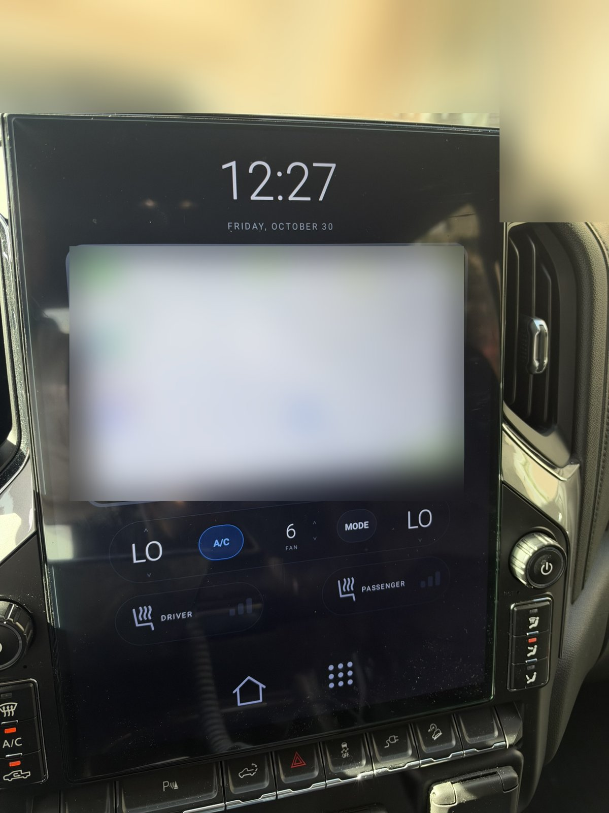
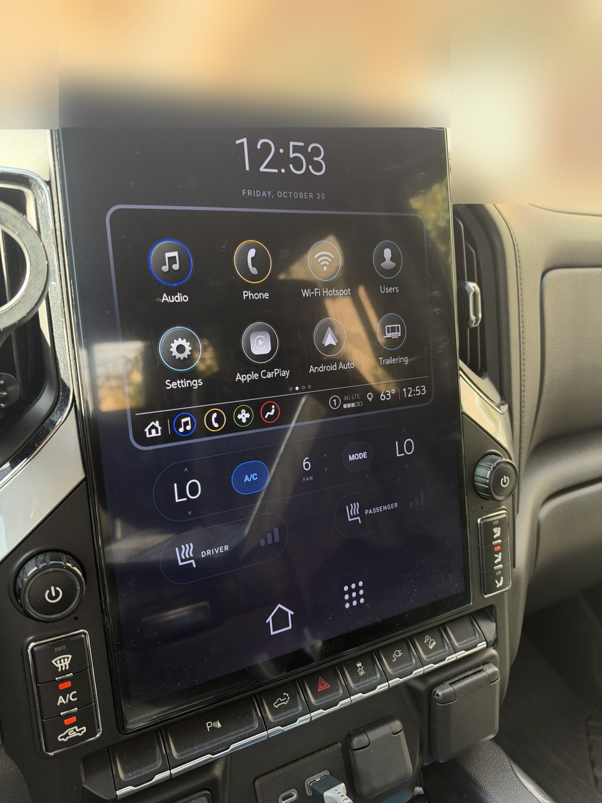
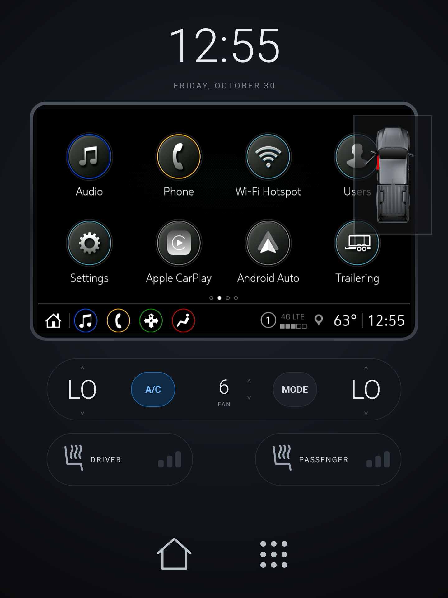
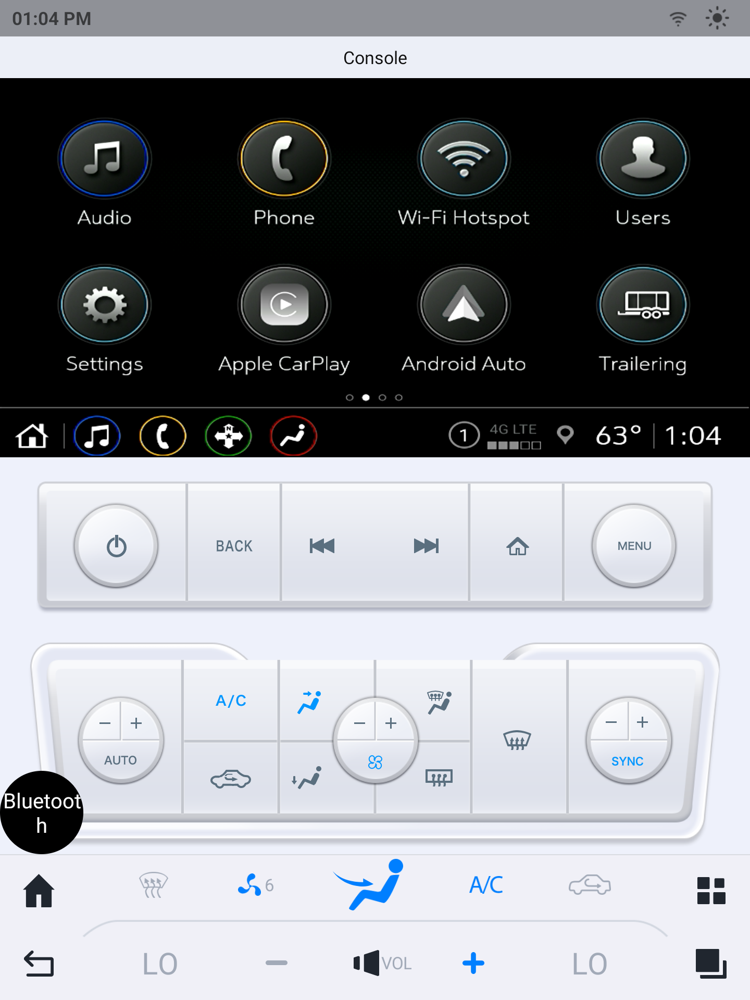

# TruckDash

A replacement home screen for the GT6-CAR / ZXW (Choiceway) tall-screen Android head units sold for
Chevy Silverado and GMC Sierra trucks. It replaces the stock "Console" app with a clean dash:
the factory GM radio picture (CarPlay, Android Auto, or the GM menus) in a framed window, a clock, live
climate controls, seat heater buttons and a simple Home / Apps bar.

It runs as a normal app. No root, no firmware changes, and it uninstalls cleanly.

| In the truck: CarPlay | In the truck: GM home screen |
|---|---|
|  |  |

| TruckDash (screen capture) | Stock Console app it replaces |
|---|---|
|  |  |

The CarPlay map is blurred on purpose.

## Why

These units show the truck's factory radio screen through a video capture input, inside a vendor app
that also carries climate buttons. The stock app is cluttered, slow to come up, and the climate panel
does not show what the truck is actually set to. TruckDash shows the factory screen bigger, keeps
climate one tap away with live values, and is the screen you get every time the truck starts.

## What it does

- **Factory screen in a frame.** The 800x480 radio feed is shown at 1.5x (1200x720) at its true
  shape. Touches on it are passed through to the radio, so CarPlay and the GM menus work as normal.
- **Live climate bar.** Driver and passenger temperature, A/C, fan speed and a MODE sheet (power, face,
  floor, windshield, max and rear defrost, recirculation, auto, sync). Values come from the truck, and are hidden rather than faked
  when unknown.
- **Seat heater quick buttons** for driver and passenger, showing the current level.
- **Clock and date**, plus outside temperature when the truck reports it.
- **Comes up at every start.** After ignition on, the dash is the screen, with a live picture.
- **Reverse camera still works.** In reverse the dash steps aside for the vendor camera and comes
  back when you shift out.
- **Own Home and Apps bar.** The system bar is hidden on the dash; the grid button opens the normal
  app list.

## Tested hardware

Tested on **one** unit in a 2022 Chevy Silverado:

| | |
|---|---|
| Head unit | GT6-CAR, ZXW/Choiceway firmware, build GT6-EAU-T16.00.050 (2025-04-22) |
| SoC / Android | Qualcomm SM6125, Android 13 (userdebug) |
| Screen | 1440x1920 portrait, density 320 |
| Unit config | customer 4, CanType 16, LogoType 349, UINumber 328 |
| Video input | LT8918 bridge, 800x480, Qualcomm AIS |

Find yours under the vendor settings (Factory / Car info) or with
`adb shell getprop | grep -i -E "customer|zxw"` and logcat lines from the Console app
(`mCanType = .., mLogoType = ..`).

> **Read this before installing on anything else.** This app sends commands to the truck's CAN bus
> (climate, seat heaters, touch) and writes the video bridge timing. Every value in it was worked out
> on the unit above. On a different head unit, firmware, truck or year, the codes may be different
> and buttons may do the wrong thing or nothing. Check the protocol notes against your own unit
> first. Use at your own risk; you are responsible for anything it does to your vehicle.

## Install

You need a computer with `adb` (Android platform-tools), a JDK 17 and the Android SDK (or Android
Studio), and the head unit on the same Wi-Fi.

1. On the head unit, enable Developer options and **Wireless debugging**, then pair from your
   computer (`adb pair <ip>:<pair-port>`) and connect (`adb connect <ip>:<port>`). The port changes
   after every ignition cycle.
2. Clone this repo and point the scripts at your unit:
   ```bash
   export TRUCK_ADB=<ip>:<port>
   ```
3. Copy the video library from **your own** unit. It belongs to the head unit maker, so it is not in
   this repo; the script pulls it out of the Console app already on your unit:
   ```bash
   scripts/dev.sh vendor-lib
   ```
4. Build, install and set it as the home app:
   ```bash
   scripts/dev.sh install
   ```
5. Turn the truck off, wait 10 seconds, and start it. The dash should come up with a live picture.
6. **Turn Wireless debugging off** when you are done. Left on, anyone on the same network who can
   pair with the unit gets a shell on it.

On a unit whose CanType is not 16, the dash still shows the radio picture, clock and climate
values, but sends no climate, seat or touch commands to the truck. See
[Adapting to another unit or vehicle](docs/how-it-works.md#adapting-to-another-unit-or-vehicle) to
enable them for yours (`UnitCheck.kt`).

**Undo:** `scripts/dev.sh uninstall` (or `adb uninstall com.jreid.truckdash`). Home falls back to the
stock launcher. The dash changes nothing else on the unit except the vendor auto-start slot, which
it points at itself; pick another app there in the vendor settings, or leave it, since an
uninstalled app is ignored.

## Make your own

The interesting part of this project is not the layout, it is the map of how the head unit works.
Everything you need to build your own dash, with a different design or for a different vehicle, is
written up in [docs/how-it-works.md](docs/how-it-works.md):

- getting the factory video onto your own surface
- sending touches and climate keys to the truck
- reading live climate state
- surviving ignition off and on, and coming up at start
- handing the screen to the reverse camera

The detailed protocol notes are in [docs/notes/](docs/notes/). To adapt it, see
[Adapting to another unit or vehicle](docs/how-it-works.md#adapting-to-another-unit-or-vehicle).

## Development

```bash
scripts/dev.sh test      # unit tests (JVM, no device needed)
scripts/dev.sh install   # always builds first
scripts/dev.sh log       # app log
scripts/dev.sh shot out.png
```

Kotlin, no dependencies beyond the Android SDK. `minSdk 29`, `targetSdk 29` (the unit is Android 13,
but the lower target keeps the vendor broadcasts and provider access simple).

## Known limits

- The video window shows only what the factory radio shows. No phone-connected detection exists, so
  there is no "plug in your phone" prompt.
- Touches on the video window are forwarded even when the picture is black.
- If the vendor video library is missing, the video window stays black (the app logs why and keeps
  running).
- Climate controls on the bar can be tapped before the first state arrives from the truck.
- Only tested on one unit and one truck.

## License

MIT, see [LICENSE](LICENSE). Not affiliated with or endorsed by GM, Chevrolet, GMC, Apple, Google,
ZXW or Choiceway. Apple CarPlay, Android Auto, Silverado and Sierra are trademarks of their owners;
names are used only to say what this works with.
